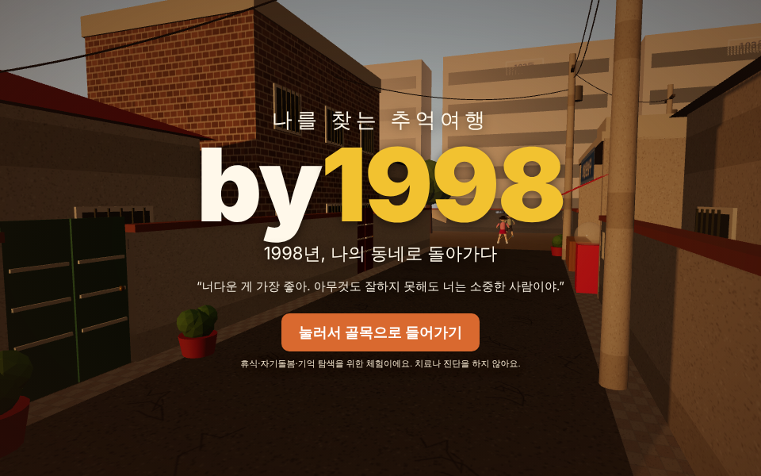
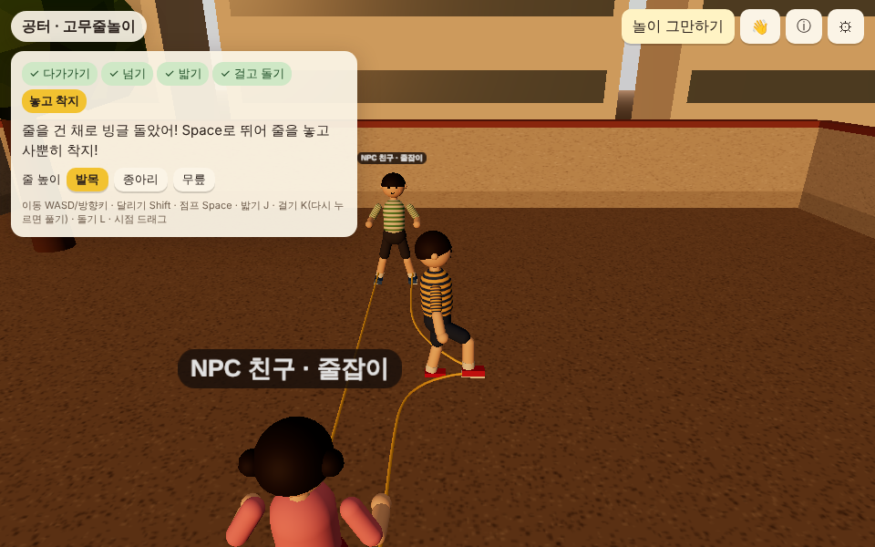
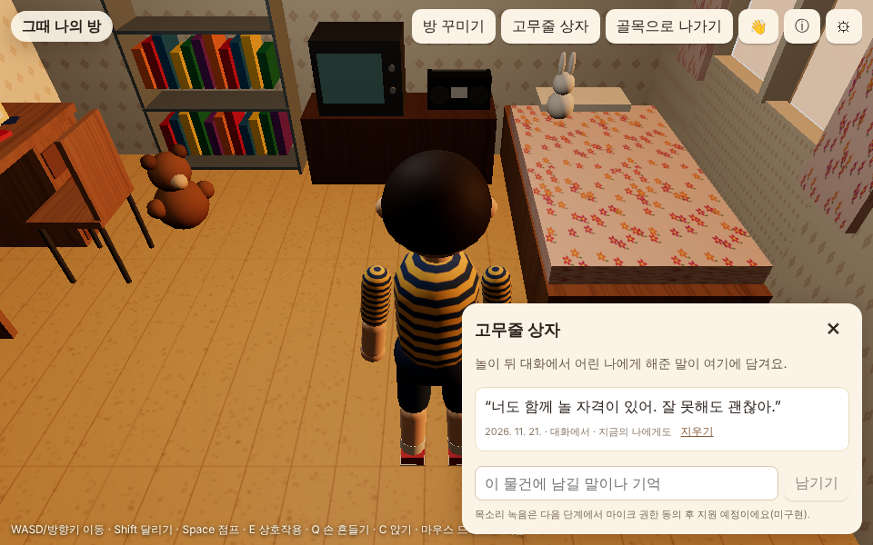

# 나를 찾는 추억여행 by1998

1998년 한국의 동네로 돌아가 골목을 걷고, 고무줄놀이를 하고, 어린 나에게 해주고 싶은 말을 방 안의 물건에 남기는 **3D 웹앱**입니다.
핵심 루프: **놀이가 기억을 깨우고 → 기억이 대화로 이어지고 → 대화가 물건에 남는다.**
휴식·자기돌봄·기억 탐색을 돕는 체험이며, 치료나 진단을 하지 않습니다.

| 타이틀(실제 3D 골목) | 고무줄 걸고 돌기 | 방 · 고무줄 상자 |
|---|---|---|
|  |  |  |

스크린샷은 E2E 실행 중 CPU 소프트웨어 렌더러로 찍은 것입니다(타이틀만 고화질 그림자).

## 실행

```bash
npm install
npm run dev          # http://localhost:5173
npm run build        # 타입체크 + 프로덕션 빌드 (dist/, Vercel 정적 배포 호환)
npm run lint
npm test             # 핵심 로직 유닛 테스트 (vitest)
npm run e2e          # 브라우저 E2E (개발 서버 실행 중이어야 함, BASE=… 로 주소 변경)
```

E2E는 Playwright(Chromium)로 실제 키 입력을 보내고 `window.__by1998` 런타임 상태(위치·애니메이션 상태·관절 각·고무줄 변형·저장 데이터)를 관찰합니다. 스크린샷은 `e2e/out/`에 저장됩니다. 렌더 루프가 멈추면 실패합니다.
CPU 소프트웨어 렌더러에서는 기본으로 '가벼운 화질'로 검증합니다(`QUALITY=high npm run e2e`로 변경).

## 조작

| 동작 | PC | 모바일 |
|---|---|---|
| 이동 / 달리기 | WASD·방향키 / Shift | 왼쪽 가상 조이스틱 |
| 시점 | 마우스 드래그, 휠 줌 | 화면 드래그 |
| 점프 | Space | 점프 |
| 밟기 · 걸기(다시 누르면 풀기) · 돌기 | J · K · L | 밟기 · 걸기 · 돌기 |
| 상호작용(문·놀이·상자) | E | 들어가기·하기 |
| 손 흔들기 · 앉기 | Q · C | 상단 👋 |

## 구현 상태 (2026-11-21, 직접 실행·E2E로 확인한 것만)

### 실제로 동작함
- **3D 1998 골목**: 연립·단독주택, 방범창, 옥상 물탱크, 콘크리트 담과 철제 대문, 전봇대·처진 전선·가로등, ‘희망문방구’ 가게, 공터(나무·평상), 원경 5층 아파트. 노을/낮/밤, 비(빗줄기·젖은 노면), 그림자(고화질), 안개.
- **3인칭 캐릭터**: 골반·척추·목·어깨·팔꿈치·손·엉덩이·무릎·발목 관절 계층. 걷기/달리기/대기/점프/공중/착지/밟기/걸기/돌기/앉기/손 흔들기 상태 기반 애니메이션(포즈 블렌딩). 카메라 추적·드래그 오빗·벽 오클루전 처리, 담/건물/가구 충돌.
- **고무줄놀이(첫 미니게임)**: NPC 줄잡이 2명(‘NPC 친구’로 명시)의 발목에 걸린 두 가닥 탄성 고무줄(Verlet 시뮬레이션). 발이 닿으면 줄이 밀리고, 밟으면 눌리고(E2E 측정 약 10cm), 걸면 발을 따라 당겨지고, 돌면 감기고(변위 약 0.6m), 놓으면 복원됩니다. 밟기·걸기는 앞의 실제 줄 위치를 찾아 한 걸음 내딛고 다리 IK로 발을 놓습니다.
  - 진행: 다가가기 → 넘기(공중에서 두 줄을 건넘) → 밟기 → 걸고 돌기 → 놓고 착지. **버튼이 아니라 관찰된 물리 상태로만** 다음 단계로 넘어갑니다. 걸어서 통과하면 넘기로 인정되지 않고, 아이가 균형을 잡는 동작과 다정한 안내만 나옵니다(탈락·감점 없음).
  - 줄 높이: 발목/종아리/무릎(데이터로 정의).
- **놀이 뒤 대화(로컬 대화 모드)**: 규칙 기반 대화 트리 — 공감 → 질문 하나 → 어린 나에게 해줄 말(선택지 또는 자유 입력) → 지금의 나에게도? → ‘고무줄 상자’에 저장. 언제든 ‘오늘은 그만할래’. 위기 표현 감지 시 109 / 1577-0199 / 112·119 안내. **LLM은 연결되어 있지 않으며 화면에 그렇게 표시됩니다.**
- **1998년의 나의 방**: 초록 대문(우리 집)으로 들어가면 전환. 장판·벽지·꽃무늬 커튼 창(창으로 드는 노을빛)·나무 책상과 서랍·베이지 PC·철제 책꽂이·브라운관 TV·카세트 플레이어·침대. 처음 들어가면 ‘실제 내 방 / 갖고 싶었던 방 / 내 방은 없었어’ 선택.
  - 책상 위 **고무줄 상자**를 누르면 저장한 말을 다시 읽기·지우기·직접 쓰기.
  - **방 꾸미기**: 소품 10종(무료)을 방바닥 3D 좌표에 놓기·돌리기·옮기기·치우기, 소품마다 기억 메모. 새로고침 후에도 유지(IndexedDB).
  - 카세트 플레이어 → 음악 선반: 곡 제목/가수와 공식 서비스(Melon, YouTube Music) 검색 링크. 음원은 앱에 없습니다.
- **모바일**: 가상 조이스틱·동작 버튼, 좁은 화면 레이아웃, 가벼운 화질 기본값. 프레임 저하 감지 시 화질 안내.
- 설정: 시간대·비·화질·자막·터치 버튼, ‘내 기록 모두 지우기’. 연결 상태 패널(ⓘ).

### 아직 모형이거나 미구현 (화면에도 ‘연결 예정/준비 중’으로 표시)
- AI API 연동(`AiCompanionAdapter`는 로컬 모드만), AI 온보딩 대화와 사용자 승인 기반 개인화 기억 구조(`favorite_music` 등).
- 사진 → 3D 아바타 생성(`AvatarGenerationAdapter` 미연결, 사진을 받지 않음), 아바타 편집기.
- 리깅된 GLB 아바타(현재는 코드로 만든 관절 캐릭터).
- 문방구 내부 탐색·구매 체험(가게 외관과 진열만 있음), 정원/‘나다운 세계’ 확장, 방의 3단계 변화.
- 목소리 녹음, 음악 직접 추가, 앱 내 음원 재생, 환경음/배경음.
- 멀티플레이(친구 초대·공개 골목·매칭·신고/차단·연령 보호) — 공개 매칭은 정책·모더레이션 준비 전까지 비활성.
- 땅따먹기·팽이치기·구슬치기·공기놀이·딱지치기(`src/game/games.ts`에 ‘준비 중’으로 등록).
- Supabase 등 원격 저장/동기화(저장은 `KvAdapter` 뒤에 IndexedDB만 구현).

## 에셋·라이선스
- 3D 모델, 텍스처(벽돌·아스팔트·장판·벽지·꽃무늬·간판 글자)는 모두 **코드로 생성한 오리지널**입니다. 외부 3D/이미지/오디오 에셋을 쓰지 않았습니다.
- 실제 브랜드·로고·캐릭터·앨범 아트는 쓰지 않았습니다. 소품 데이터에 `rights` 필드가 있어 권리 확인된 제휴 에셋을 나중에 추가할 수 있습니다.
- 음악은 제목·가수 정보와 공식 서비스 링크만 제공합니다. 발매연도는 확실한 것만 표시하고 나머지는 ‘확인 필요’로 둡니다.
- 사용 라이브러리: three, @react-three/fiber, @react-three/drei, zustand, react (모두 MIT).

## 개인정보
- 모든 기록(방 배치, 상자의 말, 방 종류)은 이 브라우저의 IndexedDB에만 저장되며 서버로 보내지 않습니다. 대화 전체는 저장하지 않고 사용자가 ‘남기기’로 고른 말만 저장합니다.
- 설정 > ‘내 기록 모두 지우기’로 삭제할 수 있습니다.

## 구조
```
src/game/       순수 로직 (유닛 테스트 대상): rope(고무줄 시뮬), rubberBand(진행 판정), animation(상태기계·포즈·다리 IK), collision, dialogue(로컬 대화), games
src/three/      3D: World1998, Alley, RubberBandGame, Room, CharacterRig, PlayerController, CameraController, PropModels, textures, Label
src/state/      input(키보드·조이스틱), runtime(프레임 상태, E2E 노출), store(zustand UI 상태)
src/services/   storage(IndexedDB KvAdapter, 기록), adapters(AI/아바타/음악/멀티플레이 연결 상태)
src/ui/         HUD, 대화, 패널, 터치 조작
docs/           MASTER_SPEC.md(최상위 개발 명세), PRODUCT_VISION.md, IMPLEMENTATION_PLAN.md
e2e/play.mjs    브라우저 E2E
```
